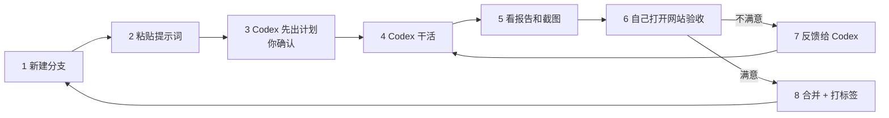

# witlu.com 操作手册：怎么一步步指挥 Codex、怎么验收

> 写给不写代码的你。照着做就行：**准备一次 → 每个阶段重复同一个循环 → 上线**。
> 配套文件都在 `d:\Google IDE\witlu\`：`AGENTS.md`（Codex 的规矩）、`docs/PLAN.md`（总体方案 v3）、`docs/CODEX_PROMPTS.md`（每阶段的提示词）、`docs/design/`（效果图）。

---

## 一、要不要 Fork 原作者的仓库？

**不需要。**正确的做法是：

1. **你自己新建一个仓库** `witlu`，所有新代码都写在这里。
2. 原作者的仓库作为「只读参考」挂进来（技术上叫 *git submodule*，放在 `upstream/` 文件夹）。Codex 只从里面**读取数据**，不会修改它。这一步在 P0 由 Codex 自动完成。

为什么不在 Fork 上直接改？原站的代码是 SVG 加原生 JS，我们要用 Three.js 全部重写，在 Fork 上改只会越改越乱。

**可选的保险措施**：如果担心原作者哪天删库，可以点一下他仓库右上角的 **Fork**，把一份副本存到你的账号下，然后在 P0 开始前告诉 Codex「submodule 指向我的 fork：`https://github.com/<你的用户名>/jiangshan-map`」。这个 Fork **只用来备份，不在上面写代码**。

---

## 二、一次性准备（大约 1 小时）

### 1. 账号
| 账号 | 用途 | 费用 |
|---|---|---|
| GitHub | 存放代码 | 免费 |
| ChatGPT（Plus 或更高） | 使用 Codex | 按 OpenAI 的订阅价格 |
| Cloudflare | 托管网站、生成预览链接 | 免费 |
| Squarespace | 你已经买好了 witlu.com | 已付 |

### 2. 电脑上要装的软件（Windows）
1. **Git**：https://git-scm.com 下载安装，一路默认即可。
2. **Node.js LTS**（22 或更高）：https://nodejs.org 下载安装。
3. **pnpm**：打开 PowerShell，运行
   ```powershell
   corepack enable
   corepack prepare pnpm@latest --activate
   ```
4. **Codex**：任选一种
   - Codex 桌面 App，或 VS Code 里的 Codex 扩展（**推荐**，有界面，好操作）；
   - 命令行版：`npm i -g @openai/codex`，然后在项目文件夹里运行 `codex`。
   - 用 ChatGPT 账号登录。如果在 Windows 上遇到兼容问题，按 OpenAI 官方文档改用 WSL。
5. **浏览器**：Chrome（验收时要用它的帧率工具）。

### 3. 建仓库，把文档放进去
1. 在 GitHub 网页上点 **New repository**：名字填 `witlu`，选 **Public**，**不要**勾选「Add README」，然后创建。
2. 打开 PowerShell：
   ```powershell
   cd "d:\Google IDE\witlu"
   git init
   git add .
   git commit -m "docs: 项目方案与 Codex 规则"
   git branch -M main
   git remote add origin https://github.com/<你的用户名>/witlu.git
   git push -u origin main
   ```
3. 在 Codex 里打开 `d:\Google IDE\witlu` 这个文件夹。

### 4. 给 Codex 的权限
- 允许它在项目文件夹内读写文件、运行命令。
- **允许联网**：安装依赖、下载地形瓦片、拉取上游仓库都需要网络。如果 Codex 报「网络被拒绝」，在它的设置里打开网络权限，或者对这一步点「批准」。

---

## 三、每个阶段都重复这个循环



### 第 1 步：新建分支（每个阶段一个分支，出了问题容易回退）
直接对 Codex 说：
> 新建并切换到分支 `p0-data`。

（P1 用 `p1-design`，P2 用 `p2-terrain`……名字随意，只要每个阶段不同。）

### 第 2 步：粘贴提示词
打开 `docs/CODEX_PROMPTS.md`，把对应阶段 ```` ``` ```` 代码块里的内容**完整复制**，然后在最前面加上这一句：
> 先完整阅读 AGENTS.md 和 docs/PLAN.md。**先不要写代码**，先列出你这个阶段的实施计划和你不确定的地方，等我确认后再开始。

### 第 3 步：确认计划
Codex 会列出计划和问题。你重点看三件事：
- 有没有漏掉提示词里的某一条？漏了就指出来。
- 它的问题你能回答就回答；涉及技术选择、拿不准的，回复「按 PLAN.md 的建议做」。
- 没问题就回复：**「确认，开始。完成后按 AGENTS.md 的完成定义交付。」**

### 第 4 步：等它干活
大的阶段可能要跑很久，中间它会请求运行命令的权限，正常批准即可。

> [!WARNING]
> **只有一种请求必须拒绝**：它想修改 `verify-parity` 的阈值、跳过测试，或者删除某个功能来「让测试通过」。这时回复：「不允许修改阈值或跳过测试，请修复根本原因。」

### 第 5 步：看它的交付物
每个阶段结束，它都应该交给你：
1. `docs/progress/Pxx.md`：做了什么、没做什么、和计划有什么不同、性能数据；
2. `docs/progress/screenshots/Pxx/`：桌面、iPhone、安卓三种尺寸的截图（有动效的阶段还有录屏）；
3. `pnpm verify` 全部通过的输出。

**少了任何一样，直接说：**「请补齐 AGENTS.md 完成定义里的全部交付物。」

### 第 6 步：自己打开网站验收
**在电脑上看**：
```powershell
cd "d:\Google IDE\witlu"
pnpm install
pnpm dev
```
在 Chrome 打开它给出的地址（一般是 http://localhost:5173）。在地址后面加 `?debug=1`，会出现**验收控制台**：能看到帧率、当前画质档，还能一键触发天象、疆域过渡等效果。

**在手机和微信里看**（P1 之后可用）：
- 把分支推送到 GitHub（对 Codex 说「推送当前分支」），Cloudflare 会自动生成一个**预览链接**（在 Cloudflare Pages 的项目页面里能看到，形如 `https://p2-terrain.witlu.pages.dev`）。
- 把链接发到自己的微信（文件传输助手），在微信里点开验收。

然后对照第四部分的验收清单逐条检查。

### 第 7 步：不满意就反馈（用模板，Codex 改得最快）
```
【问题】海面流动太快，抢了版图的注意力
【在哪】桌面 Chrome，年份 230，默认视角
【期望】流动速度减半，反光透明度再降一点，眯眼看时应先看到版图
【附件】（拖入截图或录屏）
```
**一次最多提 5 个问题**，按重要程度排序。改完再看，循环直到满意。

### 第 8 步：合并并打标签
满意后对 Codex 说：
> 把当前分支合并到 main，打标签 `p0-done`，推送到 GitHub。

**如果某次改坏了、想回到上一个满意的版本**，对 Codex 说：
> 放弃当前分支的改动，回到标签 `p1-done` 的状态，新建分支重新做。

### 小技巧
- **每个阶段新开一个 Codex 对话**。对话太长它会「忘事」，规则都写在 AGENTS.md 里，新对话会自动读取。
- 同一阶段里如果它反复改不好同一个问题（来回 3 轮以上），让它「先在 `/lab` 页面单独做一个最小演示，确认效果后再接入」。
- 每个阶段结束，可以把 `docs/progress/Pxx.md` 发给我（或任何 AI）帮你复核。

---

## 四、各阶段验收清单（不需要看代码）

> 每个阶段都要满足的通用条件：`pnpm verify` 通过；Pxx.md 和截图齐全。

### P0 · 数据导入
- [ ] 打开 `docs/progress/parity.md`：表里每一行新站的数量都 **≥** 上游，没有一行变少。
- [ ] 打开 `docs/progress/moods-review.md`：浏览一遍情绪标注，**把你觉得不对的直接改掉，或告诉 Codex 改**（例如某个事件不该下雨）。这份清单会决定以后什么时候下雨打雷。
- [ ] 打开 `docs/progress/colors.md`：确认主朝代都是金色，同一画面的颜色不超过 5 种。
- [ ] 确认 `upstream/` 文件夹里有原作者的项目。

### P1 · 设计系统与外壳
- [ ] 电脑、手机两种尺寸的截图和 v3 效果图气质一致：深蓝底、白字、玻璃面板。
- [ ] 点击玻璃按钮有「液体按压」的手感；鼠标移动时玻璃上的高光会跟着走。
- [ ] 手机上底部抽屉能拖到三档，松手会弹回，不卡顿。
- [ ] 加 `?debug=1` 能看到验收控制台。
- [ ] **手机微信能打开 Cloudflare 预览链接**，下拉页面时不会露出「网页由 xxx 提供」。
- [ ] 能切换简体、繁體、English。

### P2 · 3D 地形
- [ ] 第一眼感觉：安静、深邃，只有蓝色的海和黛青色的陆地，**没有绿、黄、棕，也没有灰**。
- [ ] 山脉立体清楚，青藏高原呈冰蓝色。
- [ ] 鼠标或手指拖动、缩放、旋转、倾斜都很顺；控制台帧率：电脑 ≥ 55，手机 ≥ 45。
- [ ] 镜头拖不出东亚范围；没有 2D 切换按钮，只有指北针 / 复位按钮。

### P3 · 海洋和云
- [ ] 盯着海看 10 秒，能看出海水在缓慢流动；岸边有淡淡的光浪。
- [ ] 每过半分钟到一分钟有云飘过，地上有很淡的云影。
- [ ] **眯眼测试**：截图后眯着眼看，海和云不应该是最显眼的东西。
- [ ] 在控制台把画质切到「省电」，效果会明显简化，但依然流畅。

### P4 · 疆域生长（最关键）
在控制台的「触发疆域过渡」里逐个播放，或打开 `/lab/morph`：
- [ ] 秦灭六国：秦的金色一国一国地推进，**不是突然跳变**；被灭的国家碎成光尘。
- [ ] 东汉 → 三国：魏、蜀、吴从各自都城晕染开来。
- [ ] 北宋 → 南宋、明 → 清、1945 → 1946 都能连续变化。
- [ ] 把滑块停在中间，画面是一个合理的「半变化」状态，**没有破洞、没有重叠、没有闪烁**。
- [ ] 倒着拖回去，版图会原路缩回。
- [ ] 手机上播放也不卡（帧率 ≥ 45）。

### P5 · 历史长河时间轴
- [ ] 时间轴是一条河：三国时分成 3 条支流（金、翡翠、珊瑚），西晋时汇合；南北朝、五代、宋辽金夏也有分流。
- [ ] 拖动有惯性，松手后慢慢停下；版图跟着同步变化。
- [ ] 播放、暂停、倍速、键盘左右键、空格都能用；输入「贞观三年」能跳到 629 年。
- [ ] 从秦拖到清（跨度很大）时，镜头会穿过云层再落下来。
- [ ] 手机上手指拖动时间轴不会误触地图。

### P6 · 章节与并行编年
- [ ] 进入新朝代时，朝代名一笔一笔写出来，印章落下。
- [ ] 230 年（三国）、500 年（南北朝）、950 年（五代）、1140 年（宋辽金夏）都**同时显示 3 条以上事件轨道**，内容对得上。
- [ ] 公元前 100 年（西汉）只有 1 条轨道，界面简洁。
- [ ] 同一年有多件事时，地图上几个地点同时亮起，镜头能把它们都框进来。
- [ ] 点图例能聚焦政权，政权档案里有君主世系。

### P7 · 天象与音效
在控制台逐个触发：
- [ ] 靖康之变、崖山海战：天变暗、下雨、闪电，过一会儿打雷，然后放晴。
- [ ] 南京大屠杀：只有细雨，没有雷，画面肃穆，不戏剧化。
- [ ] 赤壁之战：江面有火光；贞观之治：金色光束；雪拥蓝关：下雪。
- [ ] 点开音乐后才有声音；雷声比闪电晚一点。
- [ ] 4 倍速播放时，不会一直下雨打雷。

### P8 · 玻璃标记、走廊与地点
- [ ] 都城是玻璃印章、名关是玻璃城楼、古战场是玻璃双戟，转动视角能看出立体感。
- [ ] 修长城的年代城墙从地上升起；郑和时期有小船沿航线航行；丝路上有驼队光点。
- [ ] 点击「长安」能打开点地溯源卡：有名城判词、各朝沿革表、在这里发生的大事；点其中一件事能跳到那一年。
- [ ] 郡州府边界能显示，鼠标悬停有提示；古今透视镜能叠加现代省界。

### P9 · 搜索、人物、小试
- [ ] 按 `/` 打开搜索；搜「曹操」「长安」「元狩二年」「赤壁」「changan」（拼音）都有结果。
- [ ] 打开苏轼行迹：金色流星线串起各站，年份和版图同步变化，有诗句浮现。
- [ ] 输入「李白 杜甫」能同时看两人，并显示「同途」。
- [ ] 安史之乱能逐站展开，两个阵营颜色不同。
- [ ] 舆图寻址小试能玩完 10 题，并得到官阶封号。
- [ ] 古琴能播放、切歌；语音解说能开关。

### P10 · 链接、海报、开场
- [ ] 原站 README 里的链接把域名换成预览地址后都能打开，例如 `?year=208&place=赤壁`、`?person=sushi`、`?event=anshi`。
- [ ] 第一次打开网站有地球开场动画，可以跳过；第二次打开不会再出现。
- [ ] 分享海报能生成，在微信里长按能保存。
- [ ] 加 `&embed=1` 是精简的嵌入版。

### P11 · 加固与上线
- [ ] Codex 给的真机清单，你在 **iPhone 微信和安卓微信**里都逐项勾选通过。
- [ ] 一部旧一点的手机也能流畅浏览（会自动降到省电档）。
- [ ] `https://witlu.com` 和 `https://www.witlu.com` 都能打开，并有小锁图标。

---

## 五、上线：把 witlu.com 指向网站（P11 时操作）

Codex 会写好 `docs/DEPLOY.md`，下面是概要：

1. **Cloudflare Pages**（P1 时已经连接好 GitHub）：生产分支设为 `main`，每次合并到 main 都会自动更新正式网站。
2. **域名**（推荐方案 A）：
   1. Cloudflare 控制台 → Add a site → 输入 `witlu.com` → 选 Free → 记下它给的 2 个 nameserver 地址。
   2. 登录 Squarespace → Domains → `witlu.com` → DNS 设置。**先把已有的记录（尤其是邮箱 MX）截图保存**，再把 Nameservers 改为「自定义」，填入 Cloudflare 的两个地址。
   3. 等待生效（几分钟到 48 小时，Cloudflare 会发邮件通知）。
   4. Cloudflare → Workers & Pages → 你的项目 → Custom domains → 添加 `witlu.com` 和 `www.witlu.com`。
3. 在微信里打开 `witlu.com` 最终确认。

---

## 六、常见问题

| 情况 | 怎么办 |
|---|---|
| Codex 说测试没通过，想「暂时跳过」 | 不同意：「请修复根本原因，不要跳过测试。」 |
| Codex 说「这个功能做不了」 | 让它说明原因和替代方案，再决定；或者把它的说明发给我评估 |
| 下载地形瓦片很慢或失败 | 正常现象（数据量大），脚本支持断点续传，让它重新运行即可 |
| 改着改着越来越乱 | 回到上一个 `pxx-done` 标签，新开对话重做这一阶段 |
| 电脑上很流畅，手机上卡 | 把控制台的帧率截图发给 Codex：「手机上帧率只有 xx，请按 PLAN 第 8 节优化，自动降档要生效」 |
| 颜色不满意 | 只改 `tokens.css` 和配色脚本里的参数，不要让它到处改；可以说「只调整 PLAN 1.2 色板中的 xx 颜色」 |
| 不知道某阶段做得好不好 | 把 `docs/progress/Pxx.md` 和截图发给我帮你看 |

---

## 七、时间与费用预估

| 阶段 | 预计（每天投入 1–2 小时） |
|---|---|
| 准备 + P0–P1 | 1 周 |
| P2–P4（3D 引擎、海洋、疆域生长，最难） | 2–4 周 |
| P5–P7（时间轴、并行编年、天象） | 2–3 周 |
| P8–P10（标记、搜索、链接、海报） | 2–3 周 |
| P11（手机加固 + 上线） | 1 周 |
| **合计** | **约 2–3 个月** |

费用：Codex 用你的 ChatGPT 订阅（工作量大时，较高的套餐额度更充裕）；Cloudflare 免费；域名已买。不需要服务器，不需要备案。
