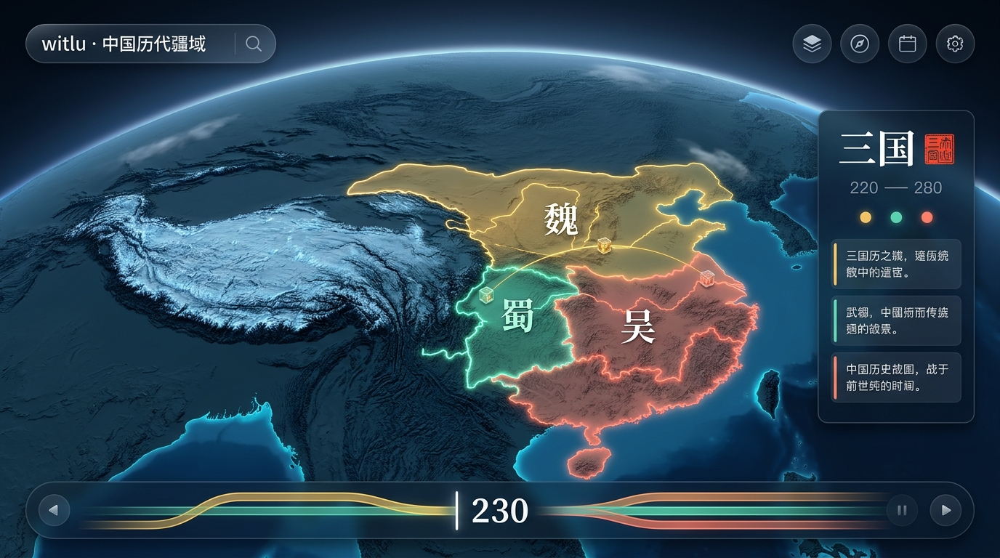
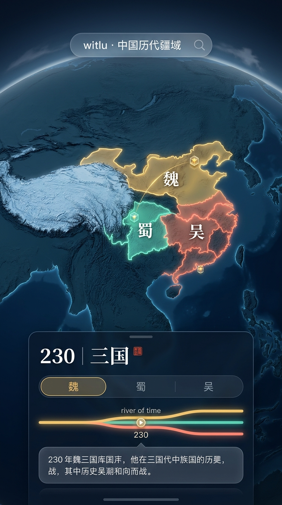
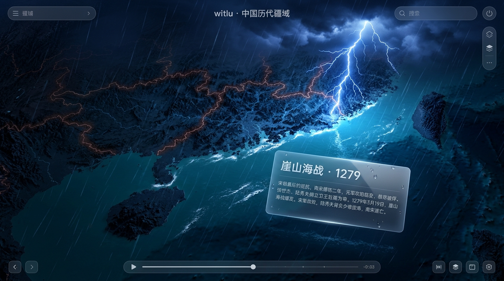

# witlu.com · 中国历代疆域 — 总体方案 v3

> **v3 变化（配色重做）**：底图改为**深色单色调**（夜蓝海洋 + 黛青单色地形），全图只有政权是饱和色；主朝代统一用金色，并立政权只从 3 个颜色中选；文字改为白色系；新增「注意力分层」规则和「验收控制台」。配套的操作手册见 `docs/GUIDE.md`。
>
> v2 相对 v1 的变化：**只保留 3D** · 底图改为**彩色地形浮雕风格**（参照你提供的图） · 海水持续流动、云从天上飘过 · 新增**天象系统**（悲惨事件下雨打雷等） · **Liquid Glass 玻璃界面与 3D 玻璃图标** · 新增「历史长河」时间轴和一批创意动效 · 全部图层上线（个人非商业用途） · 渲染引擎由 MapLibre 改为 **Three.js** · 新增网页 → 微信小程序 / App 的代码复用说明（第 12 节）。
>
> 数据全部来自 [DeanChensj/jiangshan-map](https://github.com/DeanChensj/jiangshan-map)（GPL-3.0）。配套文件：`AGENTS.md`、`docs/CODEX_PROMPTS.md`。

---

## 0. 已确认的前提

| 事项 | 结论 |
|---|---|
| 用途 | 个人和朋友观赏，**非商业** |
| 图层 | **全部上线**，包括郡/州/府（CHGIS）和现代省界 |
| 视角 | **只有 3D**，不做 2D 切换 |
| 许可义务（仍需遵守） | ① 页脚和「关于」注明「数据与原始设计源自 江山时序 Jiangshan Atlas」和 CHGIS 引用格式；② GPL-3.0 要求源码可获取：仓库建议公开（郡州府数据不提交进我们的仓库，构建时从上游子模块读取） |
| 合规 | 页面保留「历史疆域为示意性近似」；现代国界必须准确（见第 11 节） |

---

## 1. 视觉总纲 v3：「夜蓝山河，金色江山」

### 1.1 设计思路
- **底图退后，主角突出**：地图只用**两种冷色**（蓝色的海、黛青色的陆地），起伏只靠明暗表现，不再用绿、黄、棕等多种颜色。全画面**唯一的饱和色是政权疆域**，再加上白色文字和金色动效，视线自然落在「版图 + 文字 + 变化」上。
- **深而不闷**：原站压抑，是因为用了浑浊的棕褐色加低对比度。v3 用的是**通透的夜蓝色**，文字、边界和光效都是高亮的，顶部地平线有一圈淡淡的天光，整体是「苹果深色模式」那种干净、高级的感觉。
- **去灰原则仍然有效**：所有深色都带蓝色倾向，不使用纯黑或中性灰。
- **历史感**：宋体标题、朱砂印章、书法落笔，三处足够。

### 1.2 色板（全站只用这些颜色）
| 角色 | 颜色 | 用途 |
|---|---|---|
| 深海 | `#0B1F3A` | 远洋 |
| 大陆架 | `#12345C` | 中等深度 |
| 近岸 | `#1C4F80` | 浅海，靠近海岸 |
| 海面流光 | `#4F8FD6`，透明度 ≤ 25% | 缓慢移动的反光和洋流线 |
| 海岸线 | `#6FB3FF`，透明度 35% | 1px 细光边 |
| 陆地 · 低地 | `#1A2E3B` | 平原、盆地 |
| 陆地 · 丘陵高原 | `#26404F` | |
| 陆地 · 山脊受光面 | `#3D5E72` | 晕渲高光 |
| 陆地 · 雪峰 | `#9CC0D6` | 青藏高原、天山的高峰呈冰蓝色 |
| 地形阴影 | `#0F1E28` | 不用黑 |
| 河湖 | `#3C7FBF`，透明度 70% | |
| 天空 / 地平线 | `#0A1830` → `#2C5A8C` | 顶部淡淡的天光 |
| **主朝代（main）** | **金 `#F2C46D`** | 填充 40% + 金色亮边；全站的主角色 |
| 并立政权 1 | 珊瑚 `#FF8A7A` | |
| 并立政权 2 | 翡翠 `#5FD3B5` | |
| 并立政权 3 | 天蓝 `#7DB8FF` | |
| 羁縻 / 都护府（protectorate） | 所属王朝的颜色，填充 18% + 斜线纹理 | 表示间接控制 |
| 周边政权（neighbor） | **不填色**，只画 `#8FB0D8` 透明度 40% 的细线 + 名字 | 匈奴、吐蕃等不抢主角 |
| 文字 · 主要 | `#FFFFFF` | |
| 文字 · 次要 | `rgba(255,255,255,.72)` | |
| 文字 · 辅助 | `rgba(255,255,255,.50)` | |
| 强调 · 朱砂 | `#E8553E` | 印章、播放头，全站少量使用 |
| 强调 · 金光 | `#FFD27A` | 生长前沿、流星、光圈 |
| 可点击元素 | `#6CB4FF` | 链接、选中态 |

**配色规则**（写进 `build-colors.mjs`，自动执行）：
1. 每个快照中 `role = main` 的政权一律用金色。这只是沿用上游数据的标注（上游按《资治通鉴》纪年惯例确定主政权），**不代表正统评价**，「关于」页面要写明这一点。
2. `rival` 政权用「四色着色」算法，从珊瑚、翡翠、天蓝三色中分配，保证相邻政权颜色不同；三色不够时，第四色用淡紫 `#B79CFF`。
3. 同一政权在相邻快照中尽量保持同一种颜色，避免播放时颜色跳变。
4. 政权数量多的时期（十六国、五代十国），用「主要政权上色，次要政权只描边」的方式，同屏饱和色不超过 5 种。

**对比度要求**：白色文字在陆地和面板上的对比度 ≥ 7:1；金色、珊瑚、翡翠、天蓝在深色底图上的对比度都 ≥ 4.5:1。

### 1.3 注意力分层（所有视觉和动效都按这个分级）
| 层级 | 内容 | 对比度 | 动态幅度 |
|---|---|---|---|
| L0 背景 | 地形、海洋、云、洋流 | 低（底图明暗差 ≤ 25%） | 极慢；每秒移动不超过屏幕的 0.5%；云的透明度 ≤ 35% |
| L1 版图 | 政权填色、边界、都城 | 中高 | 只在疆域变化时动 |
| L2 信息 | 标题、年份、事件文字、当前事件标记 | 最高（白色、金色） | 切换时有过渡动画 |
| L3 瞬时特效 | 生长前沿、闪电、流星、光圈 | 短暂高亮 | ≤ 2 秒，结束后回到平静 |

> 如果某个背景效果抢了眼，宁可弱化甚至关掉。判断标准：截一张图，眯着眼看，最先看到的应该是版图和文字。

### 1.4 疆域的呈现
- 政权填充使用「颜色混合」：亮度取自地形晕渲（山脉起伏透出来），色相取自政权颜色；填充透明度 40%。
- 边界：同色亮线 1.5px + 外侧同色柔光 8px（Bloom），主朝代的金边最亮。
- 政权名：白色宋体，带 1px 深蓝描边，保证在任何颜色上都清晰。
- 当前没有中国政权覆盖的陆地，亮度再降低 15%，自然退后。

### 1.5 天象在深色底图上的表现
- **晴**：默认状态。
- **悲恸**：画面整体再降 20% 亮度并偏冷，政权饱和度降低 40%，雨丝为浅蓝白色，闪电为白蓝色（在深色底上非常醒目）。
- **盛世**：整体提亮 15% 并偏暖，地平线天光变成金色，金色光尘浮起。
- **肃穆**：降低饱和度，没有雷，只有细雨。
- 天象过渡 1.2 秒，结束后 3 秒内恢复。

### 1.6 界面：深色 Liquid Glass（参考苹果 iOS 26 深色模式）
**面板和按钮**（CSS 实现，所有浏览器都能用）：
```css
.glass {
  background: linear-gradient(135deg, rgba(28,52,88,.62), rgba(10,24,48,.48));
  backdrop-filter: blur(24px) saturate(160%);
  border: 1px solid rgba(160,200,255,.22);
  box-shadow:
    inset 0 1px 0 rgba(255,255,255,.28),      /* 顶部高光边 */
    inset 0 -10px 20px rgba(80,140,220,.10),  /* 底部内反光 */
    0 16px 40px rgba(2,10,24,.45);            /* 深蓝投影 */
  color: #FFFFFF;
}
.glass::before { /* 镜面高光：跟随指针，手机上跟随陀螺仪移动 */
  background: radial-gradient(circle at var(--mx) var(--my), rgba(255,255,255,.18), transparent 45%);
}
```
- 渐进增强：在 Chromium 内核（桌面 Chrome、安卓微信）上额外加 SVG `feDisplacementMap` **折射**效果，让玻璃后面的地图产生轻微弯曲。
- 按下时玻璃像液体一样轻微形变（scale 0.96 + 高光收缩），松手时弹回。

**图标**：统一的「3D 玻璃图标」规范，用分层 SVG 实现：半透明有色底 → 内部符号 → 顶部弧形高光 → 底部彩色反光 → 柔和的彩色投影。整套图标包括：搜索、图层、音乐、语言、分享、播放 / 暂停、上一个 / 下一个、复位、更多。

**地图标记是真正的 3D 玻璃物体**（Three.js 实时渲染）：
| 标记 | 造型 |
|---|---|
| 都城 | 玻璃**印章方块**，内部刻都城名，中心有政权颜色的光芯 |
| 天下名关 | 玻璃**汉阙城楼**（低面数模型） |
| 古战场 | 玻璃**交叉双戟**，事件发生时迸出火星 |
| 诗词名胜 | 玻璃**卷轴** |
| 一般大事 | 发光**玻璃珠** |
| 人物行迹站点 | 玻璃**灯笼** |

材质：高画质档用 `MeshPhysicalMaterial`（透射、IOR 1.5、清漆、薄膜彩虹色）；手机用省性能的「仿玻璃」着色器（菲涅尔 + 环境反射 + 折射偏移）。

**Logo**：玻璃印章，印文「江山」，作为 favicon、PWA 图标和开场动画元素。

### 1.7 字体
- 界面：`-apple-system, "SF Pro Text", "PingFang SC", "Microsoft YaHei", "Noto Sans SC", sans-serif`
- 标题：思源宋体 SemiBold 子集（约 100KB）
- 朝代名书法落笔：使用 Make Me a Hanzi 笔画数据（Arphic 许可，非商业可用），只需要 18 个朝代名和少量标题字

---

## 2. 创意与动效总表

> 原则：每个动效都要讲一件历史上的事。所有动效接入画质档位（第 8 节）和 `prefers-reduced-motion`。

### 2.1 环境（一直在发生，营造「活的山河」）
| ID | 效果 | 实现要点 |
|---|---|---|
| A1 | **海水缓慢流动** | 水面着色器：两层不同方向、不同速度滚动的法线贴图 + 柔和的月光式反光 + 按海底深度着色（近岸 `#1C4F80` → 深海 `#0B1F3A`）。东海、南海、印度洋、太平洋全部覆盖。**属于 L0 背景层：流动要能看出来，但不能抢眼** |
| A2 | **洋流** | 黑潮（台湾以东向东北）、南海环流用透明度 ≤ 25% 的蓝色流线粒子表示，速度很慢 |
| A3 | **海岸光浪** | 构建期烘焙「离岸距离场」，着色器生成一圈圈涌向海岸的**淡蓝色**光浪（不用白色），到岸边消散 |
| A4 | **云从天上飘过** | 实例化柔边云片按风向漂移，每 30–60 秒飘来一两团；**透明度 ≤ 35%，略带蓝色**，在地面投下很淡的移动阴影；镜头拉近时云渐隐 |
| A5 | **光影缓变** | 太阳方位角在 3 分钟内缓慢往复 ±15°，山体阴影随之移动 |
| A6 | **鸟群** | 偶尔有一行雁阵从北向南飞过（只在秋冬主题的事件附近出现，彩蛋性质） |
| A7 | **待机巡游** | 闲置 30 秒后，镜头沿当前疆域的边界慢速环绕；触碰屏幕立即停止 |

### 2.2 叙事（时间推进时触发）
| ID | 效果 | 触发 |
|---|---|---|
| B1 | **疆域生长 + 金色前沿** | 任何疆域变化（第 6.3 节） |
| B2 | **水墨晕染开国** | 新王朝建立：政权颜色像墨滴落入宣纸，从都城向外晕开，再接上 B1 的生长 |
| B3 | **灰飞烟灭** | 王朝灭亡：被吞并区域颜色褪去，碎成光尘被风吹散（GPU 粒子，按 SDF 前沿生成） |
| B4 | **迁都光带** | 都城变化：一条光带从旧都飞到新都，新都的玻璃印章「落印」 |
| B5 | **长城拔地而起** | 修筑长城的年代：3D 城墙从地面升起（顶点动画），城墙上的光点依次点亮 |
| B6 | **运河注水** | 大运河开通：水流光从起点一路流到终点 |
| B7 | **丝路驼队** | 丝路开通期间：一串发光小点（驼队）沿丝路缓慢往返 |
| B8 | **郑和宝船** | 1405–1433：玻璃小船队沿航线航行，船后有白色航迹 |
| B9 | **黄河改道** | 改道年份：旧河道慢慢变干、淡出，新河道水流蜿蜒推进 |
| B10 | **书法落笔开篇** | 进入新章节：朝代名一笔一笔写出 → 朱砂印章落下 → 章节概述淡入 |
| B11 | **诗句浮现** | 行迹站点有诗句时，诗句以竖排宋体浮现在该地上空，3 秒后随风消散 |
| B12 | **穿越云层** | 大跨度跳转（> 300 年）：镜头拔高穿过云层，年份数字高速滚动，然后俯冲回到新时代 |
| B13 | **流星轨迹** | 镜头在事件或站点之间飞行时，划出金色流星弧线 |
| B14 | **同期共鸣** | 多条轨道同年都有事件时，这些地点同时泛起光圈，彼此之间连上淡淡的光丝 |
| B15 | **残影淡出** | 生长结束后，上一阶段边界以朱砂虚线显示，3 秒内淡出（保留上游功能 F10） |

### 2.3 天象系统（事件的情绪 → 天空和天气）
每条事件在构建期标注一个**情绪**（`moods.json`：先按关键词规则自动生成，再人工审校），时间走到该事件时，天象在 1.2 秒内过渡到对应预设，持续约 6 秒后恢复晴朗。

| 情绪 | 天象 | 示例事件 |
|---|---|---|
| **悲恸** | 整体降低亮度、偏冷，云层从北方压过来，下雨（浅蓝白色雨丝 + 海面雨点涟漪），远处白蓝色闪电劈下 + 雷声，疆域饱和度降低 40%（见 1.5 节） | 长平之战、靖康之变、风波亭、崖山海战、土木之变、甲申之变、扬州十日、圆明园被焚、甲午战争 |
| **肃穆** | 细雨无雷、光线柔和变暗、飘落少量白色花瓣；事件卡片去掉亮色 | 南京大屠杀等近现代重大惨案（**不做任何戏剧化效果**） |
| **征战** | 战场升起烟尘、火星飘散、镜头轻微震动（每次 ≤ 2 次） | 长平、官渡、淝水、安史之乱等战役 |
| **火攻** | 江面燃起火光，倒映在水中 | 赤壁之战（彩蛋级演出） |
| **盛世 / 一统** | 整体提亮偏暖，地平线天光变成金色，丁达尔光束穿过云隙，金色光尘浮起 | 秦统一、汉武开边、贞观、开元、永乐、康乾 |
| **远行** | 风起，沙尘微光（西域）或海风帆影（海上） | 张骞、玄奘、郑和 |
| **诗意** | 雪（雪拥蓝关）、月（李白）、春花（兰亭） | 文学类地标事件 |
| **天灾** | 洪水沿河道漫开 | 黄河决口、改道 |

- **声音**：雨声、雷声（闪电后延迟 0.6–1.2 秒）、风声、靠近海岸时的海浪声，和古琴背景音乐混音。默认静音，用户点一下音乐按钮后才开启。
- **节制**：同一时期内天象演出最多每 10 秒一次；倍速播放到 4× 时只保留天色变化，不下雨不打雷。

### 2.4 交互
| ID | 效果 |
|---|---|
| C1 | 玻璃按钮的液态按压和弹回 |
| C2 | 玻璃高光随指针（桌面）或陀螺仪（手机）移动 |
| C3 | 悬停政权：该政权像一片玉板一样微微浮起（约 20km 高度）并带柔和投影 |
| C4 | 点击地点：地面泛起水波纹，玻璃标记弹起 |
| C5 | 拖动时间轴：「历史长河」中的水流跟随拖动方向加速流动 |
| C6 | 安卓手机在朝代边界处轻微震动（`navigator.vibrate`） |
| C7 | 面板转场：交叉滑动 + 模糊渐清（支持的浏览器用 View Transitions API） |

### 2.5 「历史长河」时间轴（取代 v1 的多行色带）
- 时间轴画成一条**从左向右流淌的河**：统一时期是一条宽河；分裂时期**分成多条支流**，每条支流就是一个政权（颜色、宽度与疆域面积成正比）；统一时支流**汇合**。「天下大势，分久必合，合久必分」一眼就能看懂。
- 河面有缓慢流动的光点；播放头是一枚朱砂玻璃印章，年份大字显示在上方。
- 事件以小光点的形式标在对应支流上；点击直接跳转。
- 手机端是一条紧凑的长河（高 56px）；展开抽屉后显示完整长河。
- 数据来自 `coexistence.json`（政权存续区间 + 每个阶段的面积）。

### 2.6 动效编排示例（交给 Codex 作为验收样板）

**示例一：秦灭六国（前 230 — 前 221）**
| 时间 | 画面 |
|---|---|
| 0.0s | 镜头拉到中原，俯仰 45°；「历史长河」上七条支流依次汇入秦 |
| 0.4s | 灭韩：韩的颜色褪去碎成光尘，秦的金色从西向东推进，前沿闪过一道亮光 |
| 每 1.1s | 依次灭赵、魏（大梁出现水淹效果）、楚、燕、齐，每国一段生长 |
| 结束 | 全境统一：金色晨光 + 丁达尔光束；书法写出「秦」，印章落下；长城从地面升起 |

**示例二：靖康之变（1127）**
| 时间 | 画面 |
|---|---|
| 0.0s | 年份走到 1127，天色在 1.2 秒内转为深靛蓝，云层从北方压来 |
| 1.5s | 闪电劈向汴京，0.8 秒后雷声；开始下雨，海面出现雨点涟漪 |
| 2.0s | 北宋北方疆土褪色、碎成光尘向东南飘散；金的颜色向南推进到淮河 |
| 3.5s | 临安亮起微弱暖光，南宋的颜色从临安晕开 |
| 6.0s | 雨停，云散，阳光慢慢回来；事件卡使用肃穆样式 |

---

## 3. 素材盘点（全部复用、全部上线）

| 上游文件 | 内容 | 新站用途 |
|---|---|---|
| `js/map_data.js` → `DYNASTY_DATA` | 18 个时期（`phases / milestones / settlements`） | 时间模型、章节、事件、城池 |
| `js/map_data.js` → `CORRIDOR_DATA` | 长城、运河、丝路、郑和航线 | B5–B8 |
| `js/atlas_snapshots.js` + `data/atlas/**`（197 个文件，164 个快照） | 政权、一级政区、**郡州府（上线）** | 疆域与政区 |
| `js/china_geo_data.js` | 现代省界 | 古今透视镜 |
| `js/lore_core.js` | 年号（主纪年 + 并立政权）、古琴、雄关、名胜、人物、政权档案 | 并行轨道、档案 |
| `js/lore_detail.js` | 定点大事、行迹、名城题记、政权小传（约 120 个）、人物详情（约 150 人）、名关详情（20 关） | 点地溯源、点人溯事 |
| `js/i18n_dict.js`、`js/zh_hant.js`、`js/event_pinyin.js` | 英文、繁体、拼音 | 三语、搜索 |
| `assets/audio` | 5 首古琴 | 音乐 |
| `topics/*.html`（35 页） | 专题页 | 用新风格重新生成 |
| `llms.txt`、MCP、skills | AI 接入 | 保留 |
| `data/sources` | 出处 | 事件卡显示出处 |
| **新增外部数据** | AWS Terrain Tiles（含海底地形，公有领域）、Natural Earth（公有领域）、Make Me a Hanzi 笔画数据 | 地形、海岸、书法 |

`scripts/verify-parity.mjs`：新站任何一项数据计数少于上游，CI 就失败（即「元素只能多不能少」的自动保障）。

---

## 4. 功能清单

### 4.1 保留上游的全部功能（F01–F39）
F01 时间轴（改为「历史长河」） · F02 时间轴缩放 · F03 年份输入、上一个 / 下一个、Shift ±10 年 · F04 自动播放与倍速 · F05 语音解说 · F06 君主与年号 · F07 图层开关（全部，含郡州府） · F08 水系古泽与古海岸线 · F09 走廊 · F10 朱砂残影 · F11 图例悬停与聚焦 · F12 政权档案与君主世系 · F13 朝代面板 · F14 州府悬停与今属省份 · F15 古今透视镜 · F16 点地溯源卡（沿革表、都城徽章、定点大事、史事纪要、点事件跳年份） · F17 名关、名胜与古战场 · F18 万能搜索（拼音、年号解析） · F19 点人溯事 · F20 多人同看与同途 · F21 点事溯局 · F22 舆图寻址小试 · F23 古琴 · F24 简 / 繁 / 英 · F25 复位、比例尺、收起面板 · F26 引导 · F27 地图气泡与悬停提示 · F28 双击开卡 · F29 快捷键 · F30 全部深链参数 · F31 嵌入模式 · F32 地址栏同步 · F33 `atlasAPI` 与 WebMCP · F34 `llms.txt`、MCP、Skill · F35 35 个 SEO 专题页、sitemap、OG · F36 PWA · F37 周边国家与海洋 · F38 地名避让 · F39 更多菜单（含致谢）

### 4.2 新增
N1 疆域生长 · N2 历史长河时间轴 · N3 此刻天下 · N4 并行事件轨道 · N5 章节导览 · N6 3D 地形（唯一视角） · N7 开场地球 · N8 分享海报 · N9 画质自适应 · N10 出处展示 · N11 面包屑 · **N12 天象系统** · **N13 海洋与云层** · **N14 3D 玻璃标记** · **N15 Liquid Glass 界面** · **N16 书法开篇** · **N17 环境音效** · **N18 走廊动画（长城、运河、驼队、宝船）**

### 4.3 并行编年（保留 v1 设计）
- 构建期给每条事件确定所属政权（优先用 `eraRegime`，否则用事件坐标做点面判断）、轨道、重要度和情绪。
- 「此刻天下」卡片：并立政权的颜色、国号、君主与年号（`REGIONAL_ERA_TRACKS`）、都城、最近一件大事。
- 桌面最多同时显示 4 条轨道；手机用分段控件切换 + 横滑卡片。
- 同年多个事件时同时高亮（B14），镜头框住全部同期事件。
- 单一王朝时期自动收成一条轨道。

---

## 5. 布局（只有 3D）

### 5.1 桌面
- 3D 地图全屏铺满。默认俯仰 45°（允许 25°–65°），可以旋转；右上角有「指北针 / 复位」玻璃按钮。
- 左上：玻璃品牌胶囊 + 搜索；右上：玻璃图标按钮（图层、音乐、语言、分享、更多）。
- 右侧：380px 的 Liquid Glass 章节面板（书法朝代名 + 印章 → 此刻天下 → 并行轨道 → 概述）。
- 底部：玻璃时间坞 =「历史长河」+ 年份 + 播放控件。
- 地图相机会给面板留出视觉空间，主角疆域始终位于可见区域中央。

### 5.2 手机（Apple Maps 式）
- 地图全屏，默认俯仰 40°；单指平移，双指缩放 / 旋转 / 倾斜。
- 底部玻璃抽屉三档：收起（年份 + 朝代 + 紧凑长河）→ 半开（此刻天下 + 事件卡）→ 全开（详情）。
- 横屏时改成左右分栏。

### 5.3 视觉参考
- **v3 配色以第 15 节的 v3 效果图为准。**你之前提供的彩色地形图，只参考其中的**地形浮雕质感**（山脊清晰、立体），配色不再参考。
- 新增**验收控制台**（加 `?debug=1` 后显示一个玻璃面板）：实时帧率、当前画质档、当前快照；每个特效的开关；一键触发任意天象、任意疆域过渡、任意章节开篇。这样不懂代码也能逐项验收（P1 搭框架，之后每个阶段往里加按钮）。

---

## 6. 技术架构 v2

### 6.1 为什么从 MapLibre 换成 Three.js
v2 要求的效果（流动海水、飘云及其阴影、下雨、闪电、玻璃物体、政权颜色和地形亮度混合、生长着色器）都需要**在同一个 3D 场景里自己写着色器**。MapLibre 的自定义图层不能贴合地形；按 v1 的思路用 canvas 数据源，每帧都要复制整张纹理，手机扛不住。

我们的地图范围是固定的（东亚，缩放从「全国」到「省、州」级别），不需要街道级别的瓦片，所以用 Three.js 自建引擎完全可行。而且 **Three.js 可以移植到微信小程序，MapLibre 不行**（第 12 节）。

### 6.2 技术栈
| 层 | 选型 |
|---|---|
| 仓库 | pnpm workspace（monorepo） |
| 语言 | TypeScript strict |
| 渲染 | **Three.js（WebGLRenderer，WebGL2，WebGL1 降级）** + postprocessing（Bloom、色彩分级、晕影） |
| UI | React + Zustand + Motion + Tailwind v4 |
| 计算 | Web Worker（距离场、地名碰撞、解码） |
| 几何 | earcut、@turf/turf、mapshaper（构建期） |
| 构建期图像 | sharp（地形设色、晕渲烘焙）、Node 脚本 |
| 测试 | Vitest + Playwright |
| 部署 | Cloudflare Pages |

### 6.3 仓库结构（按「可移植」分层）
```
witlu/
├─ packages/
│  ├─ core/        # 纯 TS，零 DOM、零 WebGL：数据模型、timeModel、事件 / 轨道 / 情绪、搜索、EDT 距离变换、深链解析
│  ├─ engine/      # Three.js 3D 引擎，只通过 PlatformAdapter 接触外部环境
│  │   ├─ platform/      PlatformAdapter 接口 + web 实现（canvas、rAF、图片解码、Worker、存储、音频）
│  │   ├─ terrain/       四叉树瓦片 LOD、高度图、设色底图、地形着色器
│  │   ├─ territory/     政权纹理（矢量光栅化 RTT）+ 生长着色器 + 边界线
│  │   ├─ ocean/         水面着色器、洋流、海岸光浪
│  │   ├─ atmosphere/    天空、云层与云影、雾、光照循环
│  │   ├─ weather/       雨、雪、闪电、烟尘、火光、光束（天象预设）
│  │   ├─ markers/       3D 玻璃标记（glTF + Draco）、光圈
│  │   ├─ corridors/     长城、运河、丝路、航线、驼队、宝船
│  │   ├─ fx/            流星、光尘、水墨晕染、灰飞烟灭粒子
│  │   ├─ camera/        地图相机（平移、缩放、旋转、俯仰、惯性、flyTo、穿云）
│  │   ├─ picking/       射线 → 经纬度 → 政权或政区（查标签图）
│  │   └─ labels/        只计算地名的屏幕位置和避让结果，由各平台自己绘制
│  └─ web/         # React 网站（UI、玻璃组件、面板、时间轴、音效、i18n、SEO、PWA）
├─ scripts/        # 导入、几何、标签图、地形瓦片、配色、事件、情绪、字体、专题页、parity
├─ upstream/       # 上游 git submodule
└─ AGENTS.md / docs/
```

### 6.4 地形与底图
1. `build-dem.mjs`：下载 AWS Terrain Tiles（terrarium 格式，**包含海底地形**）z0–8，范围为东亚包围盒，转换为 WebP 无损格式自托管。
2. `bake-relief.mjs`：用 sharp 从高程数据烘焙**单色调浮雕底图瓦片**：海拔只影响明暗（低地 `#1A2E3B` → 高原 `#26404F` → 雪峰 `#9CC0D6`），叠加多方向晕渲（受光面 `#3D5E72`，阴影 `#0F1E28`）和坡度明暗，色相始终保持黛青色（第 1.2 节）。输出 WebP（质量 85），z3–8（手机最高用到 z7）。陆地海洋分界使用 Natural Earth 海岸线。
3. 引擎：四叉树瓦片按屏幕误差选择精度；网格顶点在着色器中按高程位移；**陆地夸张系数 1.8，海底夸张系数 0.5**；海面是高度 0 的独立水面网格，透明处能看到海底。

### 6.5 疆域渲染与生长引擎
- **政权纹理**：每次切换快照时，在 Web Mercator 空间用 GPU 把矢量多边形光栅化到 4096×4096（手机 2048）的渲染目标，像素存政权 ID。光栅化一次就够，所以填色很清晰。地形着色器直接采样这张纹理，再按第 1.3 节的颜色混合上色。
- **生长**（沿用 v1 的距离场方案）：
  1. Worker 用 Felzenszwalb 欧氏距离变换，为涉及变化的政权分别计算 A、B 两个快照的有符号距离场；
  2. 新出现的政权从都城向外生长，消失的政权收缩回都城；
  3. 着色器中按 `argmin(mix(sA, sB, t))` 决定每个像素的归属，保证没有缝隙和重叠；
  4. 推进前沿叠加金光（B1），并沿前沿生成灰飞烟灭粒子（B3）。
  - 由于生长和静止时用的是同一张纹理管线，**不需要在矢量和栅格之间来回切换**，比 v1 简单。
- **边界线**：屏幕空间粗线（MeshLine 方式），顶点高度从高程图采样贴合地形，同色亮线 1.5px + 同色柔光（第 1.4 节）；生长期间淡出，结束后淡入。
- **时间驱动**：拖动时间轴时 t 由位置决定（可逆、可停在中间）；播放、点击和跳转时按时间补间 900–1400ms；拖得太快时退化为 120ms 交叉淡化；跨度超过 300 年时走「穿越云层」（B12）。

### 6.6 海洋（A1–A3）
- 水面着色器输入：海底深度纹理（来自高程瓦片）、离岸距离场纹理（构建期烘焙）、两张法线贴图、太阳方向、时间。
- 颜色：`mix(近岸 #1C4F80, 深海 #0B1F3A, smoothstep(0, 3000m, 深度))`，中间经过大陆架 `#12345C`；反光为柔和的冷色月光（`#4F8FD6`，≤ 25%）；菲涅尔反射天空色。
- 光浪：`sin(离岸距离 × 频率 − 时间 × 速度)` 生成淡蓝色浪线，用噪声打散，到岸边渐隐。
- 洋流：沿预设流线（黑潮、南海环流）移动的半透明长条粒子。
- 天象联动：下雨时海面变暗，叠加雨点涟漪法线。

### 6.7 天空、云层与天象
- 天空：渐变天空球（晴：天顶 `#0A1830` → 地平线 `#2C5A8C` 的淡淡天光；悲恸：更暗更冷；盛世：地平线转金色 `#C9A15A`）+ 远景雾（雾色与地平线一致）。
- 云：实例化云片（每片 3–5 层噪声纹理，柔边，朝向相机，透明度 ≤ 35%，略带蓝色），按风向漂移；云影通过同一张滚动的云覆盖纹理投到地形着色器上（很淡）。
- 雨：GPU 实例化雨丝（高画质 3 万，均衡 8 千，省电 2 千），跟随相机所在区域。
- 闪电：程序化分叉闪电线（L-system）+ 0.15 秒全局补光 + 云层内部闪光 + 延迟雷声。
- 雪、花瓣、光尘、火星：同一套粒子系统，换贴图和运动参数。
- 光束：径向模糊后处理 + 云隙遮罩。
- `WeatherDirector` 根据当前事件的情绪切换预设，负责过渡、持续时间和频率限制（第 2.3 节）。

### 6.8 标记、走廊与地名
- 玻璃标记：glTF + Draco（总计 ≤ 300KB），实例化渲染；高画质档用 `MeshPhysicalMaterial`，其余档位用仿玻璃着色器。环境贴图使用小尺寸 HDR（256px）。
- 走廊：长城为挤出的 3D 城墙带（B5）；运河和航线为流动光线；驼队和宝船为沿路径移动的实例。
- 地名：引擎在 Worker 中计算地名的屏幕坐标、优先级和碰撞结果，**网站端用 DOM 绘制**（清晰、能用系统中文字体、不用下载几 MB 的中文字体）。将来移植到小程序时，换成 canvas 2D 绘制即可。

### 6.9 拾取
射线与地形求交得到经纬度 → 查询 CPU 端缓存的政权 / 政区标签图 → 得到对象 ID。郡州府悬停、点地溯源、舆图寻址都用这一套。

---

## 7. 性能预算
| 指标 | 目标 |
|---|---|
| 首屏核心 JS + CSS | ≤ 350KB gzip（Three.js 按需引入） |
| 首次出图（4G、中端安卓） | ≤ 3s（先显示低精度地形，再逐级变清晰） |
| 帧率 | 桌面 60fps；iPhone 12、骁龙 7 系 ≥ 50fps（均衡档） |
| 生长准备时间 | ≤ 120ms（2048 网格，Worker 预计算） |
| 手机内存 | ≤ 350MB |
| Draw call | ≤ 250（实例化 + 合批） |

---

## 8. 画质档位（自动选择 + 运行中自动调节）
| 项目 | 极致（桌面独显） | 高（新手机 / 普通电脑） | 省电（旧手机 / 弱网） |
|---|---|---|---|
| 地形精度 | z8 | z7 | z6 |
| 水面 | 法线 + 月光反光 + 光浪 + 洋流 | 法线 + 光浪 | 单层法线 |
| 云 | 体积感多层 + 云影 | 单层 + 云影 | 少量云片，无云影 |
| 雨 / 粒子 | 30k | 8k | 2k |
| 玻璃标记 | 物理透射 | 仿玻璃 | 仿玻璃（无折射） |
| 后处理 | Bloom + 光束 + 色彩分级 | 半分辨率 Bloom | 关闭 |
| 像素比 | ≤ 2 | ≤ 1.5 | 1 |

运行中如果连续 2 秒帧耗时 > 22ms，自动降一档；连续 10 秒 < 12ms，则尝试升一档。设置里也可以手动选择档位。

---

## 9. 手机与微信专项
- 页面不滚动：`100dvh`、`overscroll-behavior:none`、地图 `touch-action:none`，避免微信下拉露出「网页由 xxx 提供」。
- 适配安全区和微信底部导航栏（`visualViewport`）。
- 音乐和音效必须用户点击后才开始；微信中监听 `WeixinJSBridgeReady`。
- 陀螺仪（玻璃高光 C2）：iOS 需要用户授权，放到设置里手动开启。
- WebGL 上下文丢失时自动重建；完全不支持 WebGL 时，显示预渲染的各朝代静态图 + 时间轴。
- 分享海报：微信中全屏展示，提示「长按保存 / 发送给朋友」。
- `?debug=1` 时加载 vConsole。
- 真机测试：iOS 微信、安卓微信、iOS Safari、安卓 Chrome、桌面四大浏览器。

---

## 10. 部署到 witlu.com
1. GitHub 仓库（建议公开，GPL-3.0）→ Cloudflare Pages：构建命令 `pnpm build`，输出目录 `packages/web/dist`。
2. 域名二选一：
   - **方案 A（推荐）**：Cloudflare 添加站点 `witlu.com`，到 Squarespace → Domains → DNS → Nameservers 改成 Cloudflare 给的两个地址（先把原有的 MX / TXT 记录抄过去）；然后在 Pages 的 Custom domains 中添加 `witlu.com` 和 `www.witlu.com`。
   - 方案 B：Squarespace 中添加 `CNAME www → <项目>.pages.dev`，根域名转发到 `www`。
3. 瓦片数量（约 5–8 千个文件）在 Cloudflare Pages 的限制内（每个站点 2 万个文件、单文件 25MB）。如果超出，把瓦片打包成 PMTiles 放到 Cloudflare R2。
4. 缓存：带哈希的资源和瓦片设为 `immutable` 一年；HTML 设为 `no-cache`。
5. 国内访问慢时：再考虑香港节点或 ICP 备案（第 12 节的小程序方案也需要备案）。

---

## 11. 合规提示
- 现代国界（南海诸岛、台湾、藏南、阿克赛钦）必须准确，否则可能被认定为「问题地图」，微信也可能屏蔽链接。建议现代参照层使用自然资源部标准地图服务的数据。
- 页面和海报保留「历史疆域为示意性近似，非测绘边界」。
- 近现代惨案只使用「肃穆」天象，不做戏剧化演出。

---

## 12. 网页 → 微信小程序 / App：代码能带走多少？

**结论：App 基本不用重写；微信小程序要看注册主体，个人主体需要重写界面层。现在按第 6.3 节分层开发，就能把以后的重写量降到最低。**

| 目标平台 | 做法 | 代码复用 | 工作量 | 前置条件 |
|---|---|---|---|---|
| **手机桌面图标（PWA）** | 网站本身支持「添加到主屏幕」 | 100% | 已包含 | 无 |
| **iOS / 安卓 App** | Capacitor 把网站打包成原生 App | **约 95%**（只需补启动图、状态栏、音频会话等原生配置） | 1–2 周 | Apple 开发者账号（99 美元/年）；安卓免费 |
| **桌面 App** | Tauri / Electron 打包 | 约 98% | 几天 | 无 |
| **小程序 · 方案 A：web-view 内嵌网站** | 小程序只是一个壳，里面直接打开 witlu.com | **100%** | 几天 | **必须是企业 / 组织主体的小程序**（个人主体不能用 web-view）；域名必须 **ICP 备案**并配置为业务域名；小程序本身也要备案 |
| **小程序 · 方案 B：原生小程序** | 用 Taro（React 语法）重写界面；3D 引擎通过官方 `threejs-miniprogram` 适配器运行 | `core` 100%；`engine` 约 70–80%（需实现小程序版 PlatformAdapter，地名改用 canvas 绘制，降低特效档位）；`web` 界面需重写，约 30% 能沿用逻辑 | 4–8 周 | 个人主体可用；数据和瓦片放在**已备案的 HTTPS 域名**上（小程序禁止访问未备案域名）；主包 ≤ 2MB、总包 ≤ 20MB，资源必须走 CDN |

**现在就要做的「可移植」约束**（已写进 AGENTS.md）：
1. `packages/core` 不允许出现任何 DOM、window、WebGL 代码；
2. `packages/engine` 只能通过 `PlatformAdapter` 访问画布、图片、Worker、存储和音频，不能直接用 `document`；
3. 地名、卡片等文字界面不放进引擎，引擎只输出坐标；
4. 所有数据都是 CDN 上的静态 JSON 和瓦片，没有后端，任何平台都能直接读取。

**建议**：先专心把网站做好，微信里直接分享链接就能看。以后真想上小程序，最省事的路线是「企业主体 + 域名备案 + web-view」，代码零改动。

---

## 13. 分阶段实施（逐阶段交给 Codex，提示词见 `docs/CODEX_PROMPTS.md`）

| 阶段 | 内容 | 验收 |
|---|---|---|
| P0 | monorepo 脚手架、上游导入、几何 / 标签图 / 配色 / 事件 / 情绪 / 并立数据、parity 校验 | 所有计数 ≥ 上游 |
| P1 | 设计令牌（v3 色板）、深色 Liquid Glass 组件、3D 玻璃图标集、布局外壳、手机抽屉、i18n、**验收控制台**、**Cloudflare 预览部署**（以后每次推送都会生成一个手机能打开的预览链接） | 三种视口截图；手机微信能打开预览链接 |
| P2 | 3D 引擎基础：地形瓦片 LOD、单色浮雕底图、相机、拾取、PlatformAdapter、画质档位 | 与 v3 效果图风格一致；≥ 50fps |
| P3 | 海洋、天空、云层与云影、光照循环 | 海水持续流动、云飘过且有影子 |
| P4 | 疆域纹理与生长引擎、边界线、残影、灰飞烟灭、水墨晕染 | 10 个关键过渡录屏（见提示词） |
| P5 | 时间引擎与「历史长河」时间轴 | 拖动顺滑；分合关系正确 |
| P6 | 章节面板、此刻天下、并行轨道、图例、政权档案、书法开篇、章节导览 | 三国、南北朝、五代、宋辽金夏 ≥ 3 条轨道 |
| P7 | 天象系统与音效 | 按第 2.6 节两个示例录屏 |
| P8 | 玻璃标记、走廊动画、地点卡、名关、郡州府、透视镜、河湖古泽 | F08–F17 |
| P9 | 搜索、人物行迹、多人同途、点事溯局、舆图寻址、古琴、语音解说 | 上游 README 的所有示例都能复现 |
| P10 | 深链、嵌入、AI 接口、SEO 专题页、PWA、海报、开场地球 | 深链 e2e 测试全部通过 |
| P11 | 手机与微信加固、性能、无障碍、上线 witlu.com | 真机清单通过；域名可访问 |

**最难的两步是 P2–P4（自建 3D 引擎和生长引擎）**，要留足时间反复调。每一步都让 Codex 先做 `/lab/*` 独立演示页，验证通过再接入主程序。

---

## 14. 风险与应对
| 风险 | 应对 |
|---|---|
| 自建引擎工作量大 | 先在 `/lab` 页面分模块验证；地形 LOD 可参考开源 three.js 地形瓦片方案 |
| 特效太多导致手机卡顿 | 画质三档 + 运行中自动调节；天象频率限制 |
| 天象情绪标注不准 | `moods.json` 由你最终审校；没有标注的事件默认晴天 |
| 中文地名字体 | 用 DOM 加系统字体，不下载大字体文件 |
| 国内访问慢 | 香港节点或备案后使用国内 CDN |

---

## 15. v3 效果图（当前标准）
这些图只作为**风格参考**：图里的文字是 AI 生成的（有乱码），疆域形状不准确，一律以真实数据为准。

````carousel

<!-- slide -->

<!-- slide -->

````

> v3 效果图的不足（实际开发时要比图做得更好）：桌面图的政权填充偏浑浊，实际应更通透（40% 透明度 + 亮边）；地平线的地球弧度只用于开场动画，平时的视角是倾斜的平面地图。

