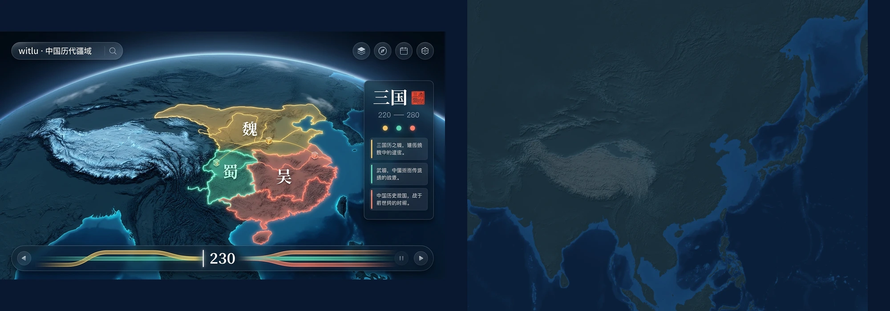
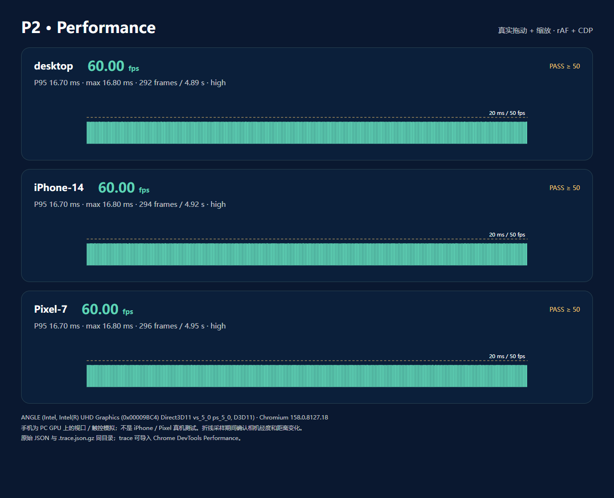

# P2 · 3D 地形与引擎基础

P2 已实现真实地形并替换 P1 静态背景。三种视口通过交互、录屏与 ≥50fps 的独立性能验收。手机数据是 PC 上的浏览器模拟，不代表移动 GPU 实测。

## 完成项

- 东亚 60°E–150°E、0°N–60°N，AWS Terrarium z0–8 无损 WebP，共 5242 张（含晕渲 halo），支持校验后断点续传、超时重试、原子写入。
- Natural Earth 固定版本海岸掩码，z3–8 单色调浮雕 4728 张，多方向晕渲与坡度明暗。z5 先预览、修订、并排对照，再批量生成。
- PlatformAdapter 和 web 实现、Three.js Renderer、视锥 / 屏幕误差四叉树 LOD、有界缓存、父瓦片回退和裙边；顶点位移陆地 ×1.8 / 海底 ×0.5，独立静态海面。
- 平移、缩放、旋转、25°–65° 俯仰、惯性、flyTo、复位、包围盒限制、单指与双指手势；只有 3D。CPU 拾取网格与 GPU 位移使用同一高程模型，返回经纬度和海拔。
- 极致 / 高 / 省电、DPR 与瓦片预算、连续帧耗时自动升降档、独立特效开关、减少动态、隐藏页面暂停、WebGL 上下文丢失恢复。
- /lab/terrain、主程序、验收台实际引擎统计、包含 WebGL 画面的截图；文字仍由 DOM 绘制，无引擎逐帧 React 重渲染。
- 新检出生产构建自动生成瓦片，补充 Cloudflare 文档与 USGS / NOAA / Natural Earth 致谢。

## 配色对照

全量解码像素的显示端亮度跨度 23.80 个百分点（上限 25），线性相对亮度最大 0.09498，白字最低对比度 7.24:1；偏离 B > G > R 的像素 0。计算口径、无损保护策略详见 [TERRAIN.md](../TERRAIN.md)。

[完整 z5 预览](relief-preview.webp) · [预览审计](relief-preview.json) · [全部 4,728 张最终文件的独立解码审计](relief-full-audit.json)。地形保留山脊细节与冰蓝高原，同时服从 L0 亮度上限；P3 的天光、动态海洋与 P4 的彩色疆域不在本阶段伪造。

## Performance

运行命令：<code>pnpm test:performance</code>，单 worker 顺序采样，画质 high 起步，自动画质开启。环境：Windows，Chromium 158.0.8127.18，ANGLE (Intel, Intel(R) UHD Graphics (0x00009BC4) Direct3D11 vs_5_0 ps_5_0, D3D11)，16 个逻辑核。移动视口分别为 iPhone 14（390×664，DPR 3）和 Pixel 7（412×839，DPR 2.625），实际渲染 DPR 由画质封顶 1.5。

| 视口 | 平均 fps | P95 ms | 最慢单帧 ms | 引擎 CPU 中位 ms | 最高 draw call | JS heap MiB | 画质 |
|---|---:|---:|---:|---:|---:|---:|---|
| desktop | 60.00 | 16.70 | 16.80 | 0.71 | 78 | 57.5 | high |
| iPhone-14 | 60.00 | 16.70 | 16.80 | 0.39 | 30 | 31.6 | high |
| Pixel-7 | 60.00 | 16.70 | 16.80 | 0.41 | 30 | 33.5 | high |

报告图来自实际 rAF 样本与 CDP 指标，不是浏览器 DevTools 面板截图。以下原始 trace 可直接在 Chrome DevTools Performance 中导入；页面截图展示同次运行的真实地形与验收台。

- desktop：[数据](performance/P2/desktop.json) · [Performance trace](performance/P2/desktop.trace.json.gz) · [运行截图](performance/P2/desktop.png)
- iPhone-14：[数据](performance/P2/iPhone-14.json) · [Performance trace](performance/P2/iPhone-14.trace.json.gz) · [运行截图](performance/P2/iPhone-14.png)
- Pixel-7：[数据](performance/P2/Pixel-7.json) · [Performance trace](performance/P2/Pixel-7.trace.json.gz) · [运行截图](performance/P2/Pixel-7.png)

最初默认 Playwright SwiftShader 软件光栅化只有约 15fps；最终验收显式使用 D3D11 并记录真实 renderer，未降低 50fps 阈值。手机采样在滚轮前校验命中 canvas，且对经度 / 相机距离变化设断言，防止将浮窗操作误计为地图性能。

全部 JS/CSS 构建资产 gzip 合计约 263.2 KiB（包含按需 Three.js、实验页和截图库）。这比 PLAN 的首屏 350KB 目标低；本数值是所有分块的保守总和，非首屏网络实测。heap 是 JS 指标，不包含完整 GPU / 系统内存；首次出图的 4G 真机指标尚未测量。

## 截图与录屏

| 视口 | 静态截图 | 交互录屏 |
|---|---|---|
| Desktop 1440×900 | [截图](screenshots/P2/desktop.png) | [平移 / 缩放 / 旋转 / 复位](recordings/P2/desktop-terrain.webm) |
| iPhone 14 | [截图](screenshots/P2/iPhone-14.png) | [平移 / 双指 / 复位](recordings/P2/iPhone-14-terrain.webm) |
| Pixel 7 | [截图](screenshots/P2/Pixel-7.png) | [平移 / 双指 / 复位](recordings/P2/Pixel-7-terrain.webm) |

[青藏地形实验页](screenshots/P2/terrain-lab-tibet.png)。P1 既有验收证据未覆盖，本轮 P1 回归产物放在 P2/regression。

## 验证

- <code>pnpm verify</code>：strict typecheck、ESLint / Stylelint / 分层规则、76 项 Vitest、全部上游 parity、9,970 张瓦片校验与 32 项 Playwright 三视口回归全部通过。16 项有意跳过：不适用视口，以及单独运行的性能 / 报告导出任务。
- <code>pnpm test:performance</code>：3 个视口的 ≥50fps、draw call ≤250 与实际相机运动断言。
- <code>pnpm build</code>：完整 assets / data / tiles / typecheck / Vite 生产构建。
- 地形相关单元测试涵盖 Terrarium 无损字节、负海拔、Natural Earth 洞、跨瓦片边缘、Mercator 往返、LOD、相机与手势、质量阈值、实际位移拾取；浏览器用 WEBGL_lose_context 验证自动恢复。

## 偏差、未完成项与已知问题

1. Three.js r180 不支持 WebGL1（自 r163 起移除），因此采用 WebGL2 并显示不支持提示；未虚构 WebGL1 降级。上下文丢失后能自动恢复。
2. 高原颜色经过 L0 明度压缩；有损 WebP 发生越界振铃时，受影响瓦片修复后改用无损编码（2,602 / 4,728 张）。使用 Natural Earth 50m land 的外缘作为海岸线；不会改写历史疆域数据。
3. 画质切换立即调整 z / DPR / 预算，现存缓存保留原网格密度，新的瓦片按新档细分，避免整屏重载。
4. 首次全量下载 / 烘焙耗时明显，需 AWS 与 GitHub 网络；运行时完全自托管。暂未提供离线首次安装包。
5. P3 的动态海洋 / 天空 / 云、P4 的政权疆域及后续所有资料图层仍待各自阶段；章节目卡片延用 P1 示例，不把背景地形当作历史疆域。
6. 没有真机 GPU、4G 冷启动及完整进程内存验收。只报告本机实际通过的三视口数据，没有声称 iPhone 12 / 骁龙 7 真机已达标。
7. 未推送分支或部署线上站点；部署指南已更新构建瓦片步骤，未修改 DNS。
